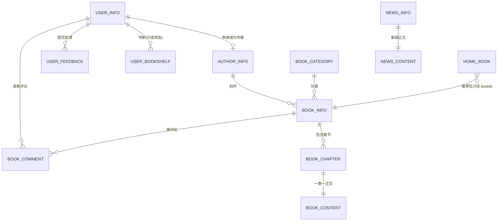

# novel-cloud 项目详解（业务向）

> 这份文档回答「这个项目到底是什么、有哪些业务、每个业务怎么跑」。
> 技术选型与踩坑见 [面试考点与坑.md](面试考点与坑.md)，简历措辞见 [简历写法.md](简历写法.md)。
> 所有路径均相对项目根目录；代码以当前工作区（优化后）为准。

---

## 1. 项目是什么

**一句话**：一个把「在线小说阅读网站」拆成微服务的学习型后端项目，前端 Vue 3 通过统一网关访问，后端提供注册登录、找书、读书、评论、搜索、作家发布等能力。

**原型**：开源项目 [novel](https://github.com/201206030/novel)（单体版）的微服务版 [novel-cloud](https://github.com/201206030/novel-cloud)，本工作区是它的**本地二次开发版**，做过一轮面向工程合理性的收敛优化（详见第 9 节）。

**为什么选小说站做微服务练习**：业务难度适中（没有商城的库存、订单、支付履约那套复杂状态机），但作为内容门户一样要面对「读多写少、热点集中、海量正文、搜索需求」——这恰好能把缓存、消息队列、搜索引擎、分布式锁这些中间件串成一条有实际业务含义的链路，而不是各写各的 Demo。

**规模（诚实口径，简历别夸大）**：

| 维度 | 实际 |
|---|---|
| Maven 模块 | 20 个（含根 pom、各聚合 pom） |
| 可启动 Spring Boot 服务 | **8 个**：网关 + 7 个业务服务 |
| Java 源文件 | 150 个 |
| HTTP 接口 | 48 个（前台 31 / 内部 10 / 作家 7） |
| 主链路业务表 | 14 张 |
| 中间件 | MySQL 8、Redis 7、Elasticsearch、RabbitMQ、Nacos、XXL-JOB（可选） |

**技术栈**：Spring Boot 3.0.5 + Spring Cloud 2022.0.1 + Spring Cloud Alibaba 2022.0.0.0-RC1、MyBatis-Plus、Spring Cloud Gateway、OpenFeign、Nacos Discovery、Caffeine、Redis/Redisson、RabbitMQ、Elasticsearch Java Client、XXL-JOB、JJWT、Undertow、 JDK 17。

---

## 2. 业务域模型：数据存在哪、怎么关联



### 核心表（主链路真正用到的 14 张）

| 表 | 关键字段 | 业务含义 / 关键约束 |
|---|---|---|
| `user_info` | `id, username, password, nick_name, user_photo, user_sex, salt` | 会员账号；`uk_username` 唯一，是并发注册的最后防线 |
| `user_bookshelf` | `user_id, book_id, pre_chapter_id` | 书架；**当前只有状态查询，没有加入/移出接口** |
| `user_feedback` | `user_id, content` | 意见反馈，删除时按 `id + user_id` 过滤防越权 |
| `author_info` | `user_id, pen_name, status, invite_code, chat_account, email` | 作家身份；一个普通用户可申请成为作家，`invite_code` 目前是占位值 `"0"` |
| `book_info` | `book_name, author_id, category_id, work_direction, book_status, word_count, visit_count, comment_count, last_chapter_id, last_chapter_name, last_chapter_update_time, is_vip, score` | 小说主表；`uk_bookName_authorName` 防重名；`last_chapter_*` 是发布章节时回写的**冗余汇总字段**（详情页不用 join 章节表） |
| `book_category` | `id, name, work_direction, sort` | 分类（男频/女频各一套） |
| `book_chapter` | `book_id, chapter_num, chapter_name, word_count, is_vip` | 章节元信息；`uk_bookId_chapterNum` 保证同书章节号唯一 |
| `book_content` | `chapter_id, content(mediumtext)` | **正文单独一张表**，`uk_chapterId`；与元数据分离，列表接口不被大文本拖慢 |
| `book_comment` | `book_id, user_id, comment_content, reply_count, audit_status` | 评论；`uk_bookId_userId` = 一人一书只能评一次；`reply_count`/`audit_status` 字段在，但回复与审核流程未实现 |
| `home_book` | `book_id, type, sort` | 首页推荐位配置，**只存 bookId 和排序**，书名封面靠 Feign 回查 book 服务 |
| `home_friend_link` | `link_name, link_url, sort` | 友情链接 |
| `news_info` / `news_content` / `news_category` | 标题、来源、正文、分类 | 门户公告 |

### 关于「遗留表」——面试必须说清

`doc/sql/init.sql` 里还有 `book_comment_copy1`、`book_comment_reply`、`user_comment`、`user_comment_reply`、`user_read_history`、`user_consume_log`、`user_pay_log`、`author_code`、`author_income`、`author_income_detail`、`pay_alipay`、`pay_wechat` 以及 `sys_*` 等一批表。

> 它们是**单体版遗留的库表结构**，本微服务版没有对应的 Service / Controller，**业务上不存在这些功能**。
> 与之配套的 Java 实体/Mapper 已在优化中删除（避免让人误以为功能已实现）。
> 表留在 DDL 里只是为了兼容原版初始化脚本；**不要把它们写进简历当成已做功能**。

---

## 3. 三种角色，各自能做什么

| 角色 | 能做的事 | 认证方式 |
|---|---|---|
| **游客** | 首页推荐/榜单/分类、小说详情/目录/正文、搜索、新闻、看验证码 | 无需登录 |
| **注册用户** | 上面全部 + 修改资料、反馈、发表/修改/删除自己的评论、查书架状态、申请成为作家 | 请求头 `Authorization` 携带 JWT |
| **作家** | 上面全部 + 新建作品、查看自己的作品/章节列表、发布章节 | 复用同一套前台 JWT，服务内再查 `author_info` 确认身份 |

> 注意：**作家不是独立账号体系**。没有管理员后台、没有角色权限表在跑，`NOVEL_AUTHOR_KEY` / `NOVEL_ADMIN_KEY` 这类常量已删除。

---

## 4. 服务拆分与职责

| 服务 | 端口 | 自己持有的数据 | 主要职责 | 依赖谁 |
|---|---|---|---|---|
| `novel-gateway` | 8888 | 无 | 8 条 URL 前缀路由 + 全局 CORS | Nacos（服务发现） |
| `novel-home` | 9001 | `home_book`、`home_friend_link` | 首页推荐位、友情链接 | Feign → book |
| `novel-book` | 9020 | `book_*` 全部 | **核心**：书/章节/正文/评论、榜单推荐、发布写链路、MQ 生产与缓存消费 | Feign → user；MQ |
| `novel-user` | 9060 | `user_*` | 注册登录、资料、反馈、书架状态、内部批量查用户 | Redis（验证码/用户缓存） |
| `novel-author` | 9010 | `author_info` | 作家入驻、状态、转发发书发章 | Feign → book；Redis |
| `novel-search` | 9050 | ES `book` 索引 | 检索、ES 增量消费、死信消费、XXL-JOB 全量同步 | Feign → book；MQ；ES |
| `novel-resource` | 9040 | 本地磁盘图片 | 图形验证码、图片上传/读取 | Redis（验证码） |
| `novel-news` | 9030 | `news_*` | 新闻列表/详情 | 无 |
| `novel-core/novel-common` | — | — | 常量、DTO、`RestResp`、`JwtUtils`、`UserHolder`、`BookChangeMsg` | 纯 jar |
| `novel-core/novel-config` | — | — | 缓存/锁/全局异常/XSS/MyBatis-Plus/OpenAPI 配置 + 公共 yml | 纯 jar |

**拆分依据**：按业务域与数据归属，每个服务持有自己的表；搜索单独拆，因为它的数据源是 ES 而不是 MySQL，伸缩和发布节奏都不同。

**网关路由**（`novel-gateway/src/main/resources/application.yml`）：`/api/front/{home,news,resource,user,book,search}/**`、`/image/**`、`/api/author/**`。
`/api/inner/**` 是 Feign 内部调用，**不经过网关**——内网直连端口可达且无额外鉴权，这是已知简化。

---

## 5. 完整接口清单（48 个）

### 前台门户（网关 8888 → 各服务）

| 前缀 | 接口 | 说明 |
|---|---|---|
| `/api/front/home` | `GET books`、`GET friend_Link/list` | 首页推荐位、友情链接 |
| `/api/front/news` | `GET latest_list`、`GET {id}` | 最新新闻、新闻详情 |
| `/api/front/resource` | `GET img_verify_code`、`POST /image` | 验证码、图片上传 |
| `/image/**` | `GET` | 由 `FileInterceptor` 直接读盘输出图片流 |
| `/api/front/user` | `POST register`、`POST login`、`GET /`、`PUT /`、`POST feedback`、`DELETE feedback/{id}`、`POST comment`、`PUT comment/{id}`、`DELETE comment/{id}`、`GET bookshelf_status` | 会员全部能力 |
| `/api/front/book` | `GET category/list`、`GET {id}`、`POST visit`、`GET last_chapter/about`、`GET rec_list`、`GET chapter/list`、`GET content/{chapterId}`、`GET pre_chapter_id/{chapterId}`、`GET next_chapter_id/{chapterId}`、`GET visit_rank`、`GET newest_rank`、`GET update_rank`、`GET comment/newest_list` | 小说浏览与互动 |
| `/api/front/search` | `GET books` | ES 检索（支持关键词、分类、方向、字数区间、时间、排序、游标） |

### 作家专区

| 前缀 | 接口 | 说明 |
|---|---|---|
| `/api/author` | `POST register`、`GET status`、`POST book`、`GET books`、`POST book/chapter/{bookId}`、`GET book/chapters/{bookId}` | 入驻、状态、建书、作品/章节列表、发章 |

### 服务内部（Feign 直连，不对外）

| 前缀 | 接口 |
|---|---|
| `/api/inner/user` | `POST listUserInfoByIds`（批量补评论昵称/头像） |
| `/api/inner/book` | `POST listNextEsBooks`（ES 同步分批拉数据）、`listBookInfoByIds`（首页批量补书信息）、`publishComment`、`updateComment`、`deleteComment`、`publishBook`、`listPublishBooks`、`publishBookChapter`、`listPublishBookChapters` |

> 这套 `/api/inner/**` 接口的业务归属很关键：**评论的真实实现在 book 服务**，user 服务只做「鉴权 + 转发」；作家发布也一样，author 服务只做身份校验 + 转发，落库在 book 服务。数据所有权没有因为调用方不同而改变。

---

## 6. 业务链路逐条拆解

### 6.1 注册（跨服务验证码约定）

```
GET /api/front/resource/img_verify_code
   → resource 服务生成 4 位数字验证码 + Base64 图片
   → 用雪花/UUID 生成 sessionId 作为一次性会话标识
   → Redis: Cache::Novel::imgVerifyCodeCache::<sessionId> = code，TTL 5 分钟
   → 返回 { sessionId, img }

POST /api/front/user/register  { username, password, velCode, sessionId }
   → user 服务（AuthInterceptor 放行 register/login）
   → VerifyCodeManager.imgVerifyCodeOk() 按同一个 Redis Key 比对
   → 查 uk_username 是否已存在
   → MD5(password) + salt="0" 写 user_info
   → 删除验证码（保证一次性，防重放/爆破）
   → JwtUtils 签发 JWT（7 天），返回 { token, uid }
```

**为什么验证码放 Redis**：多实例部署，请求可能落到任意节点，本地 Session 换台机器就验不到；而且生成方是 resource 服务、校验方是 user 服务，只有共享 Redis 能跨服务传递。sessionId 而不是 userId，是因为此时系统还不知道用户是谁。

### 6.2 登录

```
POST /api/front/user/login → 按 username 查 user_info → 比对 MD5 → 签发 JWT → 返回 token/uid/nickName
```
边界：没有失败次数限制、没有设备/会话管理、没有刷新与吊销机制。

### 6.3 首页

```
GET /api/front/home/books
  → home_book 表按 sort 读出推荐位配置（只有 bookId + 类型）
  → Feign 一次批量调 book 服务 listBookInfoByIds(ids)
  → 转 Map 做内存 join，补齐书名/作者/封面/简介
  → 结果缓存进 Caffeine（homeBookCache，24h）
```
关键点：跨服务**批量**查询而不是逐条调用（避免 N+1）；Feign 降级返回空时用 `unless` 拒绝缓存空列表，否则空首页会被缓存一整天。

### 6.4 找书：榜单 / 分类 / 推荐 / 搜索

- **榜单**：点击榜（Redis，6h）、新书榜（Caffeine，30min）、更新榜（Caffeine，60s），各取 30 条。
- **分类**：`book_category` 按作品方向查，本地缓存常驻、几乎不变。
- **同类推荐**：取同分类最近更新的 500 个 bookId 作候选池（Caffeine 1h）→ 洗牌取 4 本；过滤掉当前书本身。
- **搜索**：走 ES，见 6.6。

### 6.5 读小说

```
GET /api/front/book/{id}              → 书信息（Caffeine 18h 快照，含首章/最新章 ID）
GET /api/front/book/chapter/list      → 目录（直接查 DB，不缓存）
GET /api/front/book/content/{id}      → 章节元信息(Caffeine) + 正文(Redis 12h) + 书信息，一次聚合返回
GET .../pre_chapter_id / next_chapter_id → 按 chapter_num 相邻取一条
POST /api/front/book/visit            → SQL 原子自增 visit_count
GET .../last_chapter/about            → 最新章信息 + 正文前 30 字摘要 + 章节总数
```

**正文为什么放 Redis 而不是本地**：一章几千字，多实例各缓存一份会浪费大量堆内存；Redis 集中存一份，所有实例共享。
**点击量为什么不回写缓存**：详情页每次浏览都会 +1，每次清缓存等于让读多写少的接口全部回源 DB；点击量是展示型指标，允许 TTL 内滞后，要求精确的点击榜由独立榜单按周期重算。这是明确的最终一致取舍。

### 6.6 搜索与 ES 数据同步

```
【全量】XXL-JOB saveToEsJobHandler
   → 从 maxBookId=0 开始，每批 30 条调 book 服务 listNextEsBooks（只取 word_count>0）
   → bulk 写入 ES book 索引
【增量】作家发布章节 → MQ → search 消费者
   → 只带 bookId，回查 DB 最新数据 → 单条 index 更新
```
索引不会自动创建，**必须手工执行 `doc/es/book.http`**。查询侧：`bool` 过滤 + `multi_match`（书名^3 / 作者^2 / 简介^1）+ `function_score` 热度加权 + 高亮；普通分页用 `from/size`，深分页用 `search_after` 游标。

### 6.7 评论

```
POST /api/front/user/comment  (user 服务鉴权，从 JWT 拿 userId)
   → Feign → book 服务 /api/inner/book/publishComment
   → Redisson 锁（userId × bookId）→ 判重 → insert book_comment
GET .../book/comment/newest_list
   → 查最新 5 条 → Feign 批量 listUserInfoByIds → 内存 join 补昵称头像
```
规则：一人一书只能评一次（DB 唯一键兜底）；改/删时 WHERE 同时带 `commentId` 和 `userId`，防水平越权；Feign 降级或用户被删时用「匿名用户」兜底，不让下游故障把列表打成 500。

### 6.8 作家发布章节 ★ 全项目最重要的一条写链路

```
POST /api/author/book/chapter/{bookId}
  → author 服务：AuthInterceptor 解析 JWT + 查 authorInfoCache 确认作家身份
  → Feign → book 服务 publishBookChapter
  → BookServiceImpl.saveBookChapter()
       ① Redisson 分布式锁（key 精确到 bookId）
       ② @Transactional 开启本地事务
       ③ 查当前最大 chapter_num → +1 → insert book_chapter
       ④ insert book_content（正文独立表）
       ⑤ update book_info：last_chapter_id / name / update_time / word_count 累加
       ⑥ evict 本实例 Caffeine 的 bookInfoCache
       ⑦ 注册 afterCommit → 事务提交后投递 MQ 广播
  → fanout 广播
       ├─ search 服务：回查最新数据 → 增量更新 ES 索引
       └─ book 服务每个实例：清各自的本地缓存
```

**每一步的业务理由**：

| 步骤 | 为什么 |
|---|---|
| 归属校验 | 防止作家给别人的书发章节（`book_info.author_id == 当前 authorId`） |
| 分布式锁 | 章节号是「查 max + 1」，并发会算出同一个号撞唯一键；锁把粒度收敛到一本书 |
| 本地事务 | 三张表在同一个库，任何一步失败必须整体回滚 |
| 正文分表 | 大文本与元数据分离，目录/详情接口不被 mediumtext 拖慢 |
| 冗余汇总字段 | 详情页直接读 `book_info` 就能拿最新章信息，不用 join 章节表 |
| 清缓存 | 不清的话详情页继续返回旧的 `lastChapterId`（TTL 18h） |
| afterCommit 发消息 | 避免「消息已发但事务回滚」导致 ES 索引到库里不存在的数据 |
| 广播到所有实例 | 本地缓存是每实例一份，共享队列只会有一个实例收到（见技术文档） |

---

## 7. 数据流转全景：每个中间件存了什么

| 存储 | 内容 | 为什么 |
|---|---|---|
| **MySQL** | 14 张业务表的权威数据 | 唯一真实数据源 |
| **Caffeine（进程内）** | 分类、榜单、书信息、章节元信息、首页推荐位、推荐候选池、最新新闻 | 读多写少、体积小、追求零网络开销 |
| **Redis** | 章节正文、用户信息、作家信息、友情链接、图形验证码、MQ 幂等键、发送失败待重放列表、死信留痕 | 大文本 / 跨实例共享 / 带 TTL 的一次性数据 |
| **ES `book` 索引** | 可检索的小说文档（17 个字段） | 分词、相关度、权重、高亮、深分页 |
| **RabbitMQ** | 不存业务数据，只传「某本书变了」的事件（msgId + bookId + 类型 + 时间戳） | 解耦发布链路与索引/缓存更新 |
| **本地磁盘** | 上传的图片，按 `年/月/日` 分目录 | 静态资源 |

> 消息只带 bookId 不带业务字段，是刻意设计：消费时回查 DB 拿当前值，天然免疫消息乱序与延迟。

---

## 8. 业务规则清单（约束写在哪）

| 规则 | 落地位置 |
|---|---|
| 用户名不可重复 | `user_info.uk_username` + 注册时 `selectCount` + `DuplicateKeyException` 兜底 |
| 同一本书同一作者不可重名 | `book_info.uk_bookName_authorName` |
| 同一本书章节号唯一 | `book_chapter.uk_bookId_chapterNum` + 发布时 Redisson 锁 |
| 一章对应一份正文 | `book_content.uk_chapterId` |
| 一人一书只能评论一次 | `book_comment.uk_bookId_userId` + `@Lock(userComment)` |
| 只能改/删自己的评论与反馈 | WHERE 同时带 `id` 和 `userId`，userId 来自 JWT 而非前端 |
| 只能给自己的书发章节 | `saveBookChapter` 开头比对 `authorId` |
| 验证码一次性 | 校验通过后 `removeImgVerifyCode` 删 Redis Key |
| 无字数的空书不进搜索 | `listNextEsBooks` 过滤 `word_count > 0` |
| 响应统一格式 | `RestResp<T>`；全局 `CommonExceptionHandler` 统一转错误码 |

---

## 9. 明确「没有」的业务（最重要的一节）

| 看起来像有 | 实际情况 |
|---|---|
| 付费章节 / VIP 阅读 | `is_vip` 只是 `book_info` / `book_chapter` 上的**展示标记位**，阅读接口不拦截、不校验、不扣费 |
| 充值 / 订阅 / 消费记录 | 表在，业务代码不在 |
| 加入书架 / 移出书架 | **只有** `GET bookshelf_status` 查询状态，没有写接口 |
| 阅读历史 | 表在，阅读时不落库 |
| 评论回复 / 审核 | 表与 `reply_count`/`audit_status` 字段在，流程未实现 |
| 作家邀请码 / 收入结算 | 表在；`invite_code` 注册时硬编码 `"0"` |
| 管理员后台 / 权限体系 | `sys_*` 表在，无 Controller、无角色鉴权 |
| 网关统一鉴权 / 限流 | 网关只有路由 + CORS；认证散落在各服务拦截器 |

> 面试口径：**这些是单体版遗留的库表结构，本微服务版只实现了主线阅读业务，我主动把它们列清楚，不把它们算作已做的功能。** 想扩展付费阅读，需要「章节定价 → 下单 → 扣虚拟币（余额表 + 锁）→ 写购买记录 → 阅读校验」，扣费与订单在同一本地事务内，并用 `(userId, chapterId)` 唯一键防重复扣费。

### 本轮优化下线了什么

| 下线项 | 原因 |
|---|---|
| `novel-monitor`（Spring Boot Admin） | 与业务主线无关，Nacos 地址写死、内存弱口令、pom 插件重复 |
| ShardingSphere-JDBC 分表 | 配置要求 `book_content0..9`，而 DDL 只有单表；日志 0 条分片 SQL；双 DataSource 并存 → **配了没生效，开箱即坏** |
| 第三个「书架通知」MQ 消费者 | 类注释自认"示例"，写入的 Redis 列表无真实下游 |
| `GlobalJsonDeserializer` | 与 `XssFilter` 双重过滤，还会把密码里的 `<`/`>` 一起转义 |
| 22 个零调用实体/Mapper、死 SQL、无用常量 | 单体版复制残留，只有表没有业务 |
| 与实现不符的注释 | 「判断是否有权阅读该章节」「正文按 chapter_id%10 路由」等已更正 |

---

## 10. 怎么跑起来 / 怎么自己验证

1. 准备 MySQL 8 并执行 `doc/sql/init.sql`；启动 Redis、Nacos、RabbitMQ、Elasticsearch。
2. **手工执行 `doc/es/book.http` 建 ES 索引**，否则搜索报 `index_not_found_exception`。
3. `./start-all.ps1`（默认 `-Profile core` = gateway/book/user/search；`-Profile full` 起全部）。
4. 入口 `http://127.0.0.1:8888/api/front/...`。
5. 想完全不依赖 RabbitMQ：设 `spring.amqp.enabled=false`，发布章节仍成功，ES 靠 XXL-JOB 全量兜底。
6. 编译：本机 `JAVA_HOME` 默认是 JDK 8，需先 `export JAVA_HOME='C:\Program Files\Java\jdk-21.0.11'`，再执行 `mvn.cmd -DskipTests compile`（Git Bash 下用 `mvn.cmd`）。全 20 模块已验证 BUILD SUCCESS。

**建议自己走一遍验证链路**（面试讲"我实际跑过"才有底气）：
取验证码 → 注册 → 带 token 查资料 → 首页 → 搜索 → 小说详情 → 目录 → 正文 → 发评论 → 申请作家 → 建书 → 发章节 → 观察 MQ 日志与 ES 文档更新 → 再查详情确认最新章已变。
